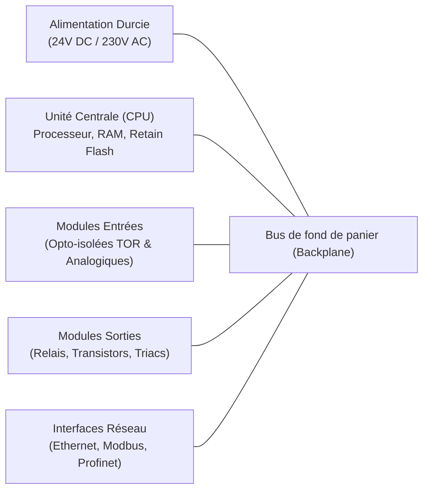

# Fiche de Cours : Fondamentaux des Automates Programmables (PLC / API)

> **Tâche liée** : [T1.2 - Suivre le cours Alison / RealPars](https://github.com/mistrecoder/plc-iot-gateway/issues/2)  
> **Auteur** : mistrecoder  
> **Date** : Octobre 2026  
> **Références** : Cours Alison « Master PLC Programming » & Vidéos pédagogiques industrielles RealPars  

---

## 1. Architecture Matérielle d'un PLC Industriel

Un automate industriel moderne se compose de 4 sous-systèmes principaux montés sur rail DIN :

### 1.1 L'Unité Centrale (CPU) & Organisation Mémoire
- **Mémoire ROM / Flash** : Contient le firmware d'OpenPLC / OS temps réel de l'automate.
- **Mémoire RAM de travail** : Contient le programme utilisateur et les tables images d'E/S (actualisées à chaque cycle).
- **Mémoire RETAIN / Rémanente** : Sauvegardée sur mémoire non volatile (ou par super-condensateur). Elle conserve les valeurs critiques (compteurs de pièces, recettes, état des étapes Grafcet) même après une coupure générale de courant.

### 1.2 Isolation Galvanique (Optocoupleurs)
Les cartes d'entrées/sorties ne sont jamais connectées directement au microprocesseur. Elles utilisent des **optocoupleurs** (barrière lumineuse interne).  
*Objectif* : Si un court-circuit ou une surtension de 400V survient dans l'atelier sur un capteur, seule l'entrée externe grille, mais le processeur de l'automate reste intact.

---

## 2. Câblage Électrique : La Notion Cruciale Sinking vs Sourcing (NPN vs PNP)

C'est l'un des concepts les plus importants en automatisme : le sens de circulation du courant continu 24V DC.

| Type | Règle mnémonique | Sens du courant | Câblage commun | Pays d'usage |
| :--- | :--- | :--- | :--- | :--- |
| **PNP (Sourcing)** | **P**ositif (**P**ush) | Le capteur **fournit** le +24V à l'entrée de l'automate. | Le commun des entrées est au **0V (GND)**. | **Standard absolu en Europe** (95% des usines). |
| **NPN (Sinking)** | **N**égatif (**N**eutral) | Le capteur tire l'entrée de l'automate vers le **0V**. | Le commun des entrées est au **+24V**. | Très courant en Asie et Japon. |

### Code couleur standard des capteurs 3 fils (IEC 60947-5-2) :
- **Fil Marron (BN)** : Alimentation **+24V DC**
- **Fil Bleu (BU)** : Masse **0V DC**
- **Fil Noir (BK)** : Signal de commutation vers l'entrée automate (`%IX`)

---

## 3. Sécurité Machine et Principe de la « Sécurité Positive » (*Fail-Safe*)

En automatisme industriel, la sécurité n'est pas seulement logicielle, elle est d'abord **matérielle** :

> **Règle d'or de l'Arrêt d'Urgence et des fins de course de sécurité :**  
> Un contact de sécurité physique (coup de poing d'arrêt d'urgence, capteur de porte ouverte, arrêt moteur) est **TOUJOURS un contact Normalement Fermé (NF / NC)** au repos.

### Pourquoi ?
Si un câble est sectionné par un chariot élévateur ou si une borne se dévisse :
- Si le bouton était Normalement Ouvert (NO), le fil coupé empêcherait à jamais le signal de passer : l'opérateur appuierait sur l'arrêt d'urgence et rien ne se passerait (danger mortel).
- Étant Normalement Fermé (NF), le fil coupé fait chuter le signal de 24V à 0V : l'automate détecte immédiatement la perte de signal et met la machine en sécurité instantanément (*Fail-Safe*).

---

## 4. Les Composants Clés de la Logique Ladder (LD)

### 4.1 Contacts & Bobines
- **Contact Normalement Ouvert `--[ ]--`** : Passe à l'état fermé si la variable associée vaut `1` (`TRUE`).
- **Contact Inversé / Négation `--[/]--`** : Passe à l'état fermé si la variable associée vaut `0` (`FALSE`).
- **Bobine standard `--( )--`** : Prend l'état du flux logique du barreau (vaut `1` si le rung est passant, `0` sinon).
- **Bobine Set `--( S )--` (Latch)** : Maintient la variable à `1` de façon permanente dès qu'une impulsion arrive (nécessite un Reset pour s'éteindre).
- **Bobine Reset `--( R )--` (Unlatch)** : Force la variable à `0`.

> ⚠️ **L'Interdiction de la Double Bobine (*Double Coil Syndrome*)**  
> En Ladder, on ne doit **JAMAIS** écrire la même bobine `( moteur )` sur deux rungs différents dans le même programme !  
> *Raison (Cycle de scan)* : Le rung 2 écrasera systématiquement le résultat du rung 1 lors de l'écriture en table image des sorties (PIO). Si le moteur doit être activé par plusieurs conditions différentes, on met ces conditions en branches parallèles sur le **même** rung.

### 4.2 Les Temporisateurs Standard IEC 61131-3
1. **`TON` (Timer On-Delay / Temporisateur Travail)** :
   - Dès que l'entrée `IN` passe à `TRUE`, le minuteur commence à compter.
   - La sortie `Q` ne s'active qu'après écoulement du délai prédéfini `PT` (ex. `T#5s`).
   - Si `IN` retombe à `FALSE`, le compteur se réinitialise immédiatement.
2. **`TOF` (Timer Off-Delay / Temporisateur Repos)** :
   - La sortie `Q` s'allume immédiatement avec `IN`.
   - Quand `IN` retombe à `FALSE`, la sortie `Q` reste allumée pendant encore la durée `PT` avant de s'éteindre (ex : ventilateur de refroidissement temporisé).
3. **`TP` (Timer Pulse / Générateur d'impulsion calibrée)** :
   - Génère une impulsion de durée fixe `PT` sur la sortie `Q` quel que soit le temps d'appui sur l'entrée.

### 4.3 Les Compteurs Standard IEC 61131-3
- **`CTU` (Count Up)** : Incrémente sa valeur courante `CV` à chaque front montant sur l'entrée de comptage `CU`. Active la sortie `Q` quand `CV >= PV` (valeur de consigne).
- **`CTD` (Count Down)** : Décrémente à partir de la valeur de charge.
- **`CTUD` (Up/Down Counter)** : Compteur bidirectionnel (ex : gestion des places d'un parking).

---

## 5. Synthèse des Concepts pour l'Entretien d'Embauche

Lors d'un entretien technique en automatisme, voici les 5 points clés à maîtriser :
1. **Cycle de scan déterministe** : Les entrées sont lues une fois par cycle (PII), le code est exécuté séquentiellement, les sorties physiques sont mises à jour en fin de cycle (PIO).
2. **Auto-maintien** : Nécessaire car les boutons physiques sont à impulsion. Réalisé soit par contact auxiliaire en parallèle (schéma classique), soit par paire Set/Reset.
3. **Sécurité positive** : Les boutons d'arrêt sont câblés en NF physique pour que toute coupure de câble déclenche un arrêt sécurisé.
4. **Pas de double bobine** : Utiliser la mise en parallèle des conditions logiques.
5. **Types IEC 61131-3** : `BOOL` (1 bit), `BYTE` (8 bits), `INT` (16 bits), `REAL` (32 bits virgule flottante).
