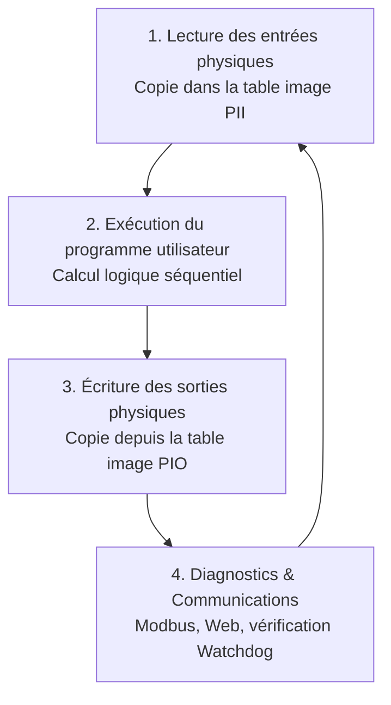

# Notes Semaine 1 : Fondamentaux PLC & OpenPLC v4

> **Tâche liée** : [T1.1 - Installer OpenPLC v4 et comprendre le cycle de scan](https://github.com/mistrecoder/plc-iot-gateway/issues/1)  
> **Auteur** : mistrecoder  
> **Date** : Octobre 2026  
> **Statut** : En cours / Prêt pour validation  

---

## 1. Qu'est-ce qu'un Automate Programmable Industriel (PLC / API) ?

Un **PLC** (*Programmable Logic Controller*, ou **API** pour *Automate Programmable Industriel*) est un calculateur durci conçu pour automatiser des processus industriels temps réel (usines, convoyeurs, stations de pompage, feux de signalisation, etc.).

Contrairement à un PC classique ou un microcontrôleur standard :
- Il est conçu pour fonctionner **24h/24, 7j/7** dans des environnements sévères (poussière, température, vibrations, parasites électromagnétiques).
- Son exécution est **déterministe** : les instructions sont répétées dans une boucle temporelle prévisible appelée **Cycle de Scan**.
- Il suit la norme internationale **IEC 61131-3**, qui standardise les types de données, les variables et 5 langages de programmation :
  1. **LD** (*Ladder Diagram*) : schéma à contacts graphique, hérité des relais électromécaniques.
  2. **FBD** (*Function Block Diagram*) : blocs fonctionnels reliés par des signaux.
  3. **ST** (*Structured Text*) : langage textuel structuré (très proche du Pascal/C).
  4. **IL** (*Instruction List*) : langage type assembleur (déprécié dans les versions récentes).
  5. **SFC** (*Sequential Function Chart* / Grafcet) : graphe d'étapes et transitions pour les automatismes séquentiels.

---

## 2. Le Cycle de Scan (*Scan Cycle*)

Le cœur du fonctionnement d'un automate repose sur une boucle infinie strictement cadencée, découpée en 4 phases principales :

### Phase 1 : Lecture des entrées (*Input Scan*)
L'automate lit l'état physique de tous ses capteurs (boutons-poussoirs, détecteurs inductifs, capteurs de pression) et copie ces valeurs dans une zone mémoire interne appelée **Table Image des Entrées** (*Process Image Input* - PII).  
*Règle clé* : Pendant l'exécution du programme, les valeurs des entrées restent figées dans cette mémoire image, même si le capteur physique change d'état au milieu du cycle.

### Phase 2 : Exécution logique (*Logic Execution*)
Le microprocesseur exécute séquentiellement les lignes de code (les « échelons » ou *rungs* en Ladder, ou les instructions en Structured Text), de haut en bas et de gauche à droite.  
Les calculs utilisent les valeurs stockées dans la table image des entrées et modifient les variables internes et la **Table Image des Sorties** (*Process Image Output* - PIO).

### Phase 3 : Écriture des sorties (*Output Scan*)
Une fois tout le programme évalué, l'automate transfère simultanément l'état de la table image des sorties vers les modules physiques (relais, contacteurs moteurs, électrovannes, voyants).

### Phase 4 : Tâches de service et communications (*Housekeeping & Comms*)
L'automate effectue ses autodiagnostics (état de la batterie, détection de défauts), réinitialise le minuteur de sécurité (**Watchdog Timer**) et traite les requêtes de communication réseau (serveur Modbus TCP, interface Web, programmation).

> **Notion critique : Le Temps de Cycle (*Scan Time*) et le Watchdog**  
> Le temps total pour exécuter un cycle complet s'appelle le **Scan Time** (typiquement de 1 ms à 50 ms).  
> Si un bug logiciel (ex. une boucle infinie `WHILE` bloquante) empêche le cycle de se terminer avant le délai du **Watchdog**, le PLC se met immédiatement en mode sécurité (*Fault / Stop*) et coupe toutes les sorties physiques pour éviter tout accident.

---

## 3. Adressage et Types d'E/S (Norme IEC 61131-3)

Dans OpenPLC et les systèmes compatibles IEC 61131-3, chaque variable physique ou mémoire possède une adresse normalisée sous la forme :

$$\% \text{[Emplacement]} \text{[Taille]} \text{[Numéro]}$$

### 3.1 Emplacement (Préfixe de localisation)
- `%I` : **Input** (Entrée physique - lecture seule depuis le capteur).
- `%Q` : **Output** (Sortie physique - écriture vers l'actionneur).
- `%M` : **Memory** (Mémoire interne / bit interne / mot interne, lecture et écriture).

### 3.2 Taille des données (Préfixe de largeur)
| Préfixe | Type IEC | Nombre de bits | Plage / Description | Exemple |
| :--- | :--- | :--- | :--- | :--- |
| **X** (ou rien) | `BOOL` | 1 bit | `0` (FALSE) ou `1` (TRUE) | `%IX0.0` (bouton marche), `%QX0.1` (moteur) |
| **B** | `BYTE` | 8 bits | 0 à 255 | `%IB0`, `%MB10` |
| **W** | `WORD` / `INT` | 16 bits | 0 à 65 535 (ou -32768 à +32767) | `%IW0` (entrée analogique 0-10V, 4-20mA), `%QW1` |
| **D** | `DWORD` / `DINT` / `REAL` | 32 bits | Entier 32 bits ou virgule flottante | `%MD0` (consigne PID flottante) |
| **L** | `LWORD` / `LINT` / `LREAL` | 64 bits | Entier long ou flottant double précision | `%ML0` |

### 3.3 Correspondance avec le protocole Modbus (Standard OpenPLC)
OpenPLC mappe automatiquement les adresses IEC 61131-3 sur les tables de registres Modbus standard :
- `%IX` $\rightarrow$ **Discrete Inputs** (Fonction Modbus 02)
- `%QX` $\rightarrow$ **Coils** (Fonctions Modbus 01, 05, 15)
- `%IW` $\rightarrow$ **Input Registers** (Fonction Modbus 04)
- `%QW` / `%MW` $\rightarrow$ **Holding Registers** (Fonctions Modbus 03, 06, 16)

---

## 4. Architecture de notre banc d'essai OpenPLC v4

Notre environnement de travail se compose de deux outils complémentaires :

1. **OpenPLC Editor v4** (sur Windows) :  
   - Environnement de développement intégré (IDE).
   - Permet de dessiner les schémas Ladder, programmer en Structured Text, déclarer les variables d'E/S et tester le code en **simulation pas-à-pas**.
   - Génère le code C++ et le binaire compilé (`.st`).

2. **OpenPLC Runtime v4** (conteneur Docker `openplc-runtime` sur le port 8443) :  
   - Moteur d'exécution temps réel exécuté sous Linux.
   - Héberge le serveur Web de supervision et d'administration (`https://localhost:8443`).
   - Fait tourner le serveur **Modbus TCP** (port `502`) qui permettra la passerelle IoT (Python $\rightarrow$ MQTT $\rightarrow$ Grafana).
